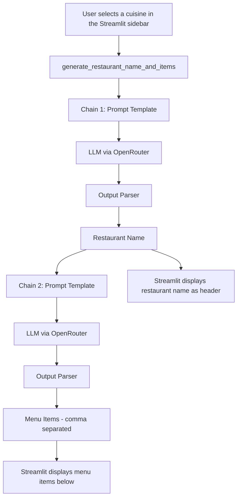

# Restaurant Name Generator


A Streamlit app that generates a fancy restaurant name and a matching menu for a cuisine of your choice, using two chained LangChain LLM calls served through OpenRouter.

## Features

- Pick a cuisine from a simple sidebar dropdown
- Chain 1 generates a fancy restaurant name for the chosen cuisine
- Chain 2 takes that name and generates a matching list of menu items
- Powered by any OpenAI-compatible model available on [OpenRouter](https://openrouter.ai)

## Architecture



## Project Structure

| File | Description |
|---|---|
| `main.py` | Streamlit UI: cuisine selector and rendering of the generated name and menu |
| `langchain_helper.py` | LangChain logic: prompt templates, LLM client, and the two chained calls |
| `.env.example` | Template for required environment variables |
| `requirements.txt` | Python package dependencies |

## Getting Started

1. Clone the repository
   ```bash
   git clone https://github.com/<your-username>/langchain-restaurant-name-generator.git
   cd langchain-restaurant-name-generator
   ```

2. Create and activate a virtual environment
   ```bash
   python -m venv .venv
   source .venv/bin/activate
   ```

3. Install the requirements
   ```bash
   pip install -r requirements.txt
   ```

4. Copy `.env.example` to `.env` and add your OpenRouter API key
   ```bash
   cp .env.example .env
   ```

5. Run the app
   ```bash
   streamlit run main.py
   ```

## Environment Variables

| Variable | Description |
|---|---|
| `OPENROUTER_API_KEY` | API key from [OpenRouter](https://openrouter.ai/keys), used to authenticate requests to the LLM |

> **Note:** OpenRouter requires the account behind the API key to have available credits, otherwise requests will fail even with a valid key.

## Example Cuisines to Try

- Pakistani
- Singaporean
- Bangladeshi
- Taiwanese

## Security Note

API keys are never committed to this repository. The `.env` file is listed in `.gitignore` — always keep your real key there and never hard-code it in source files.
